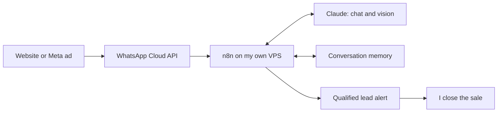

# Fabián Navarro

### I build AI systems that run a real business.

Civil Computer Engineer (*Ingeniero Civil en Informática*) and founder of [Soultech Chile](https://soultech.cl), a laptop repair business in Chile. I've worked with generative AI since its early ChatGPT days. Today I use it in two ways: inside the products I run, and as my daily tool for building them.

[**soultech.cl**](https://soultech.cl) · [**LinkedIn**](https://www.linkedin.com/in/fabi%C3%A1n-navarro-5745b8227/)

---

## Featured: Soultech Chile

A live sales system: the website starts the conversation, an AI agent diagnoses and quotes on WhatsApp, and I close the deal.

**In production since July 2026** · 460+ WhatsApp contacts · 5,500+ logged messages · 31 prompt versions

| Challenge | How I solved it |
|---|---|
| Customers don't know their specs | Vision reads a photo of Task Manager and extracts RAM, disk and CPU |
| The model misread some values | Told it where to read each field, and to answer "not visible" instead of guessing |
| Bots forget the conversation | Each reply includes the customer's recent history |
| Leads go cold | Once qualified, I get an alert with a summary |
| Abuse and prompt injection | Rate limits, message truncation, token caps and security rules in the prompt |
| Cost per conversation | A small, fast model (Claude Haiku) on self-hosted infrastructure |

I iterate by reading real conversations, finding where the bot failed, changing the prompt and testing again.

**Stack:** `Claude API` `n8n` `WhatsApp Cloud API` `Docker` `Caddy` `Linux` `Cloudflare` `HTML` `CSS` `JavaScript`

[**Visit the site**](https://soultech.cl) · [**Website code and screenshots**](https://github.com/fanavar/SoultechChile)

---

## More systems I've built with AI

These run privately; the source code is not public.

| Project | What it does | Stack |
|---|---|---|
| **Garmin Health OS** | Sends a daily training report to Telegram. Python does all the math; Claude only interprets the results. | Python, pandas, SQLite, Streamlit, Claude API |
| **Financial Intelligence OS** | Local app that separates personal and business finances, with traceable figures and 78 automated tests. | Python, FastAPI, SQLite, JavaScript |
| **Local business prospector** | Finds local businesses from open map data and prepares personalized samples. Every message is sent by a person. | Python, OpenStreetMap, Claude Code |

## How I work with AI

- **Calculations belong in code.** The model interprets; it doesn't do the math.
- **People make the final call.** AI qualifies and drafts; a person closes and sends.
- **Real failures drive changes.** I test against what customers actually wrote.
- **Privacy by design.** Sensitive data stays local whenever it can.

## Background

**Ingeniero Civil en Informática** (Civil Computer Engineer), [Universidad del Bío-Bío](https://www.ubiobio.cl/w/) · Android development with Kotlin and Java · Python · SQL · SAP University Alliances certification

Spanish (native) · English (intermediate) · Portuguese (intermediate)
